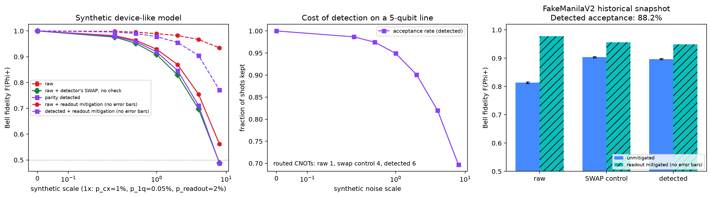

# Q TRUST

## When Does Error Detection Make a Bell Pair Worth Trusting

**Research question:** At what data-noise levels does parity-based error detection improve a Bell-state experiment, and when does the detector overhead outweigh the benefit?

The controlled X-error experiment is a sanity check: parity detection raises conditional fidelity on the error it was designed to catch, at the cost of extra gates and discarded shots. The stronger result appears under device-like noise. Detection never beats the raw circuit across the synthetic sweep, and a large apparent gain on the historical `FakeManilaV2` snapshot disappears against a SWAP-only control. The gain came from measuring on a better qubit, not from the parity check. For this modeled error budget, readout mitigation is the better matched intervention.



## Track 3 Challenge Mapping

| Track requirement | Q TRUST implementation |
|---|---|
| Known correct answer | The target is the Bell state `|Phi+> = (|00> + |11>)/sqrt(2)` with exact correlations `XX=1`, `YY=-1`, `ZZ=1`. |
| Ideal and noisy baselines | Seeded Aer simulation sweeps independent data-qubit bit flips from `p=0.00` to `0.20` and compares raw fidelity with `F=(1-p)^2+p^2`. |
| Error handling | An ancilla measures even Z parity. Syndrome-one shots are rejected before all three correlation estimates. |
| Improvement versus cost | Every result reports fidelity uncertainty, accepted shots, shot multiplier, qubits, depth, gates, CNOTs, and measurements. |

This project follows the general "Catch the Error" direction in the Qompute Track 3 brief and extends it with a detector-noise operating map.

## Experiment

The raw circuit prepares `|Phi+>` with a Hadamard and CNOT. An explicit Aer Pauli channel then applies an independent X error to each data qubit with probability `p`.


The protected circuit adds one syndrome ancilla. Two CNOTs copy the data qubits' Z parity onto the ancilla. The experiment accepts `s=0` and rejects `s=1`. Detector imperfections are modeled by a two-qubit depolarizing channel after each parity-check CNOT with `q` in `{0, 0.005, 0.010, 0.020}`.


Z-basis agreement alone cannot distinguish an entangled Bell state from a classical mixture of `00` and `11`. Q TRUST therefore measures X, Y, and Z correlations and estimates target-state fidelity as

```text
F(Phi+) = [1 + <XX> - <YY> + <ZZ>] / 4
```

For each correlation `C`, the standard error is `sqrt((1-C^2)/N)`, using retained shots after postselection. The three correlation errors are propagated into the fidelity error. All settings use 8,192 shots per basis, simulator seed 2026, transpiler seed 2026, and transpiler optimization level 0.

## Results

The raw simulation followed the analytic bit-flip curve with a maximum absolute fidelity deviation of **0.0072** across the sweep. The ideal detector rejected every observed odd-parity event, so its retained sample had unit target fidelity in this controlled channel.


<!-- RESULTS_TABLE_START -->
| p | Raw fidelity | Detected fidelity | Acceptance | Shot multiplier | Helped? |
|---:|---:|---:|---:|---:|:---:|
| 0.02 | 0.956 +/- 0.002 | 1.000 +/- 0.000 | 0.962 | 1.04x | Yes |
| 0.05 | 0.905 +/- 0.002 | 1.000 +/- 0.000 | 0.900 | 1.11x | Yes |
| 0.10 | 0.821 +/- 0.003 | 1.000 +/- 0.000 | 0.819 | 1.22x | Yes |
| 0.20 | 0.687 +/- 0.004 | 1.000 +/- 0.000 | 0.679 | 1.47x | Yes |
<!-- RESULTS_TABLE_END -->

The experiment script regenerates this table from `results/summary_results.csv`; no result is entered by hand.

### Accuracy and Sampling Cost

Detection's conditional-fidelity gain comes from discarding data. At `p=0.20`, it retained 67.9% of shots, so each retained event cost about 1.47 raw shots. The cost plot compares simulated acceptance with the analytic even-error probability.


### Circuit Cost

These are maximum counts across the X, Y, and Z measurement circuits after transpilation for Aer at optimization level 0. Noise-channel instructions are excluded from gate counts because they describe the simulated environment rather than executable correction gates.

| Resource | Raw | Parity detected | Added cost |
|---|---:|---:|---:|
| Qubits | 2 | 3 | +1 |
| CNOTs | 1 | 3 | +2 |
| Measurements | 2 | 3 | +1 |
| Maximum depth | 5 | 7 | +2 |
| Maximum transpiled gate count | 6 | 8 | +2 |

### Detector Usefulness

The detector-noise grid separates two regimes. With perfect data at `p=0`, detector depolarizing noise only caused harm: at `q=0.02`, target fidelity fell by 0.0178. At the first nonzero grid point, `p=0.01`, all tested detectors produced a positive conditional-fidelity gain, although the `q=0.02` gain was only 0.0041. At `p=0.10, q=0.02`, detection improved fidelity by 0.1606 while accepting 80.6% of shots.


Cells are centred on the sampled `(p, q)` values, so the grid is not uniform. The black contour is the sampled boundary where detected and raw fidelity are equal. The grid supports an operating-region claim, not a universal hardware threshold.

### Does It Still Help Under Device-Like Noise?

The controlled channel above is, by design, the kind of error a Z-parity check catches, so the ideal-detector
column is a sanity check rather than a discovery. `run_hardware_experiment.py` repeats the raw-versus-detected
comparison under a device-like model: depolarizing error on **every** two-qubit gate (including the Bell CNOT and the
detector CNOTs), small single-qubit error, **readout error**, and routing on a five-qubit line based on the
`ibmq_manila` coupling map, where the detector's second CNOT costs a SWAP. The synthetic baseline is defined as
`p_cx=0.010`, `p_1q=0.0005`, and `p_readout=0.020`; all three probabilities are scaled together without mapping the
scale to a hardware generation. The calibration snapshot shipped as `FakeManilaV2` is run once as supplied and once
with readout error removed. It is a historical reference, not evidence of current hardware performance. Readout-error
mitigation uses a 4x4 assignment-matrix inversion from four calibration circuits because it targets an error the parity
check cannot see.

**The comparison needs a control.** Routing the detector moves `data_1` from physical qubit 2 to qubit 3, so the
detected circuit reads its data from different qubits than the raw circuit does (the `data_qubits` column in the CSV
records this). On a device with uneven readout error that move alone changes the answer. The study therefore also runs
**raw + swap**: the Bell pair plus the same SWAP, with no parity check. Detected minus raw + swap is what the check
itself does; raw + swap minus raw is what the routing costs. The readout-mitigation matrix is calibrated on the qubits
each circuit's data bits are actually read from after routing, not on the initial layout.

| Noise source | Raw | Raw + swap (control) | Parity detected | Acceptance | Raw + readout mitigation* | Detected + readout mitigation* |
| --- | --- | --- | --- | --- | --- | --- |
| synthetic 0.5x baseline | 0.964 +/- 0.001 | 0.952 +/- 0.002 | 0.959 +/- 0.002 | 0.975 | 0.995 | 0.990 |
| synthetic 1x baseline | 0.929 +/- 0.002 | 0.908 +/- 0.002 | 0.919 +/- 0.002 | 0.949 | 0.989 | 0.978 |
| synthetic 4x baseline | 0.755 +/- 0.004 | 0.698 +/- 0.004 | 0.711 +/- 0.004 | 0.820 | 0.967 | 0.905 |
| `FakeManilaV2` historical snapshot | 0.814 +/- 0.003 | 0.904 +/- 0.002 | 0.897 +/- 0.003 | 0.882 | 0.978 | 0.949 |
| `FakeManilaV2` snapshot, readout error removed | 0.981 +/- 0.001 | 0.957 +/- 0.002 | 0.949 +/- 0.002 | 0.982 | 0.982 | 0.950 |

\* Mitigated fidelity error bars are deliberately omitted. The assignment-matrix solve clips negative corrected
probabilities and renormalizes them, so the ordinary binomial plug-in estimate does not capture calibration uncertainty,
inversion covariance, or clipping bias. `results/hardware_results.csv` retains unmitigated shot-only errors and records
this scope explicitly in `uncertainty_scope` for every row.

Routed circuit cost on the line: raw **1 CNOT, depth 8**; raw + swap **4 CNOTs, depth 11**; detected **6 CNOTs,
depth 13** (two detector CNOTs plus one SWAP). The full table is regenerated into `results/hardware_results.csv`.

Three things change once the noise is realistic:

1. **Under depolarizing gate noise plus readout error, the parity check never beats the raw circuit.** At every scale
   the detected fidelity is below raw (-0.002 at 0.25x baseline to -0.075 at 8x baseline) while 1-30 % of shots are discarded. Measured
   against the control that pays the same routing, the check itself recovers only +0.003 to +0.018, less than the
   routing costs (-0.006 to -0.073), and it is blind to the readout error that dominates the remainder.
2. **Readout mitigation is the lever the budget points to.** Each 4x4 assignment matrix uses four calibration circuits.
   Calibrating both measured qubit pairs therefore requires eight circuits, or 65,536 calibration shots per noise source
   at 8,192 shots per circuit. It discards no experiment shots and recovers +0.03 (0.5x baseline) to +0.21
   (4x baseline) of fidelity on every noise source.
3. **On the `FakeManilaV2` snapshot the detector looks like it pays (+0.08 over raw), and the control shows it does
   not.** Qubit 2 in that snapshot has a 9.6 % readout error against 2.2 % on qubit 1 and 1.4 % on qubit 3. The raw
   circuit reads `data_1` on qubit 2; the routed detector reads it on qubit 3. Raw + swap, which makes the same move
   and runs no check, reaches 0.904 while keeping every shot; detection reaches 0.897 while discarding 12 % of shots,
   most of them syndrome readouts on the noisy qubit 2 rather than caught data errors. With the snapshot's readout
   error removed, detection costs 0.032 against raw and 0.007 against the control, the same sign as the synthetic
   sweep. The gain came from qubit placement, which is error *suppression*, not from error detection.

## Limits on the Claim

- The controlled channel contains independent X errors and is not a complete IBM hardware model.
- The Z-parity check catches odd parity changes. It does not detect arbitrary phase errors.
- This is error detection with postselection, not fault-tolerant error correction.
- Real detector CNOTs add errors, routing, calibration drift, and execution time that this compact model does not fully represent.
- Simulator evidence does not establish practical hardware performance. The synthetic device model is depolarizing plus symmetric readout error; the `FakeManilaV2` snapshot adds relaxation but is a 2021 calibration, not a current device.
- Assignment-matrix readout mitigation assumes uncorrelated, stationary readout error, and its matrix is only valid for the physical qubits it was calibrated on; it is reported alongside, not instead of, the raw numbers.
- Mitigated uncertainty is not fully propagated. Its judge-facing error bars are omitted because calibration sampling, matrix inversion, and clipping bias are not included in the simple shot-noise estimator.
- The raw + swap control isolates the parity check from the routing cost on this one layout. Another layout, or a three-CNOT nearest-neighbour check, would split the costs differently.
- Fidelity estimates have finite-shot uncertainty. The reported zero plug-in error for an observed perfect correlation follows the specified estimator and does not prove a zero true error rate.
- The 0.5 target-state witness concerns overlap with `|Phi+>`; it is not universal certification of a device or application.

## Societal Impact

Trust has an access cost. Postselection uses extra qubits and gates, consumes more shots, and discards paid cloud results. At the high end of this experiment, retaining one shot required about 1.47 raw shots. Well-funded groups can repeat experiments until uncertainty shrinks, while students and smaller institutions may have to accept weaker evidence.

Quantum results should therefore publish raw and handled outcomes together with acceptance, resource overhead, noise assumptions, and uncertainty. Reporting only the improved postselected number can mislead people who later rely on quantum claims in medicine, finance, energy, or public policy.

## Reproduce

Any Python 3.11+ environment works; the exact versions used for the recorded results are pinned in `requirements.txt` and `environment.yml`.

```
pip install -r requirements.txt            # or: conda env create -f environment.yml && conda activate qtrust
python run_experiment.py                   # controlled X-error study -> results/, figures/
python run_hardware_experiment.py          # device-like study -> CSV, figure, and hardware_run_metadata.json
pytest                                     # scientific and integration checks
jupyter nbconvert --to notebook --execute --inplace notebooks/QTrust_Demo.ipynb
```

Useful runner options are `--shots`, `--seed`, `--skip-detector-grid`, `--skip-fake-manila`, and `--output-dir`.
The full workflow takes a few minutes on a laptop.

## Repository Guide

```text
src/qtrust/             circuit, analysis, experiment, and plotting modules
run_experiment.py       one-command reproducible workflow (controlled channel)
run_hardware_experiment.py  device-like noise study (synthetic sweep + FakeManilaV2 snapshot)
tests/                  focused scientific and integration checks
results/                basis-level and aggregated CSV data, plus metadata for both studies
figures/                generated circuits and result figures
notebooks/              executed judge-facing demonstration
CHALLENGE_README.md      preserved organizer brief
CITATIONS.md             sources and reused-material disclosures
```

## Team and Submission

- Team: **NoQompute** — Jason Kang, Rut Patel, Resham Patil, Alan Ma
- Repository: [github.com/pknomad/qompute2026](https://github.com/pknomad/qompute2026)

## References and License

See [CITATIONS.md](CITATIONS.md) for the challenge, Qiskit, Bell-state, and parity-check sources. The code is released under the [MIT License](LICENSE). No code or prose from the supplied starter notebook was copied into the implementation.


