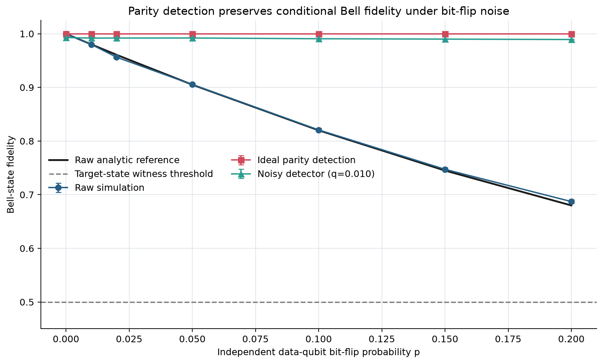
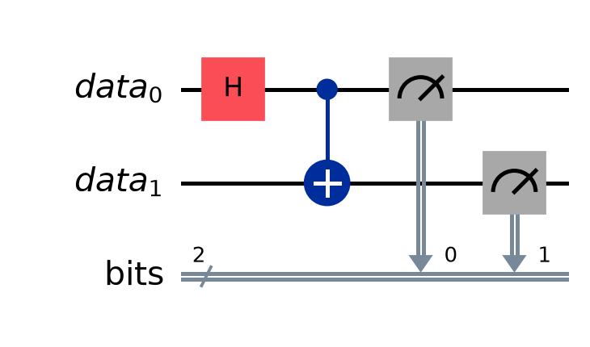
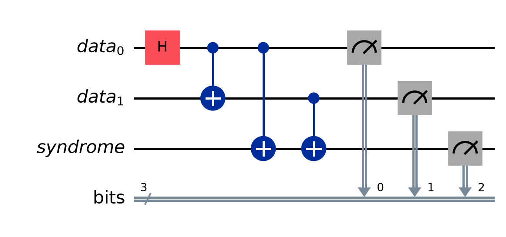
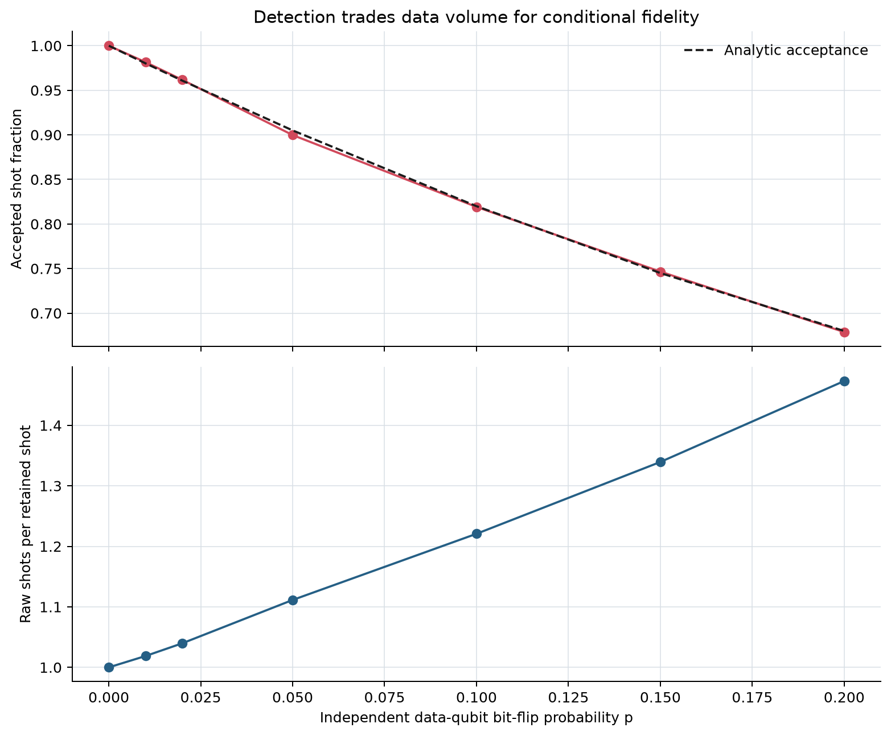
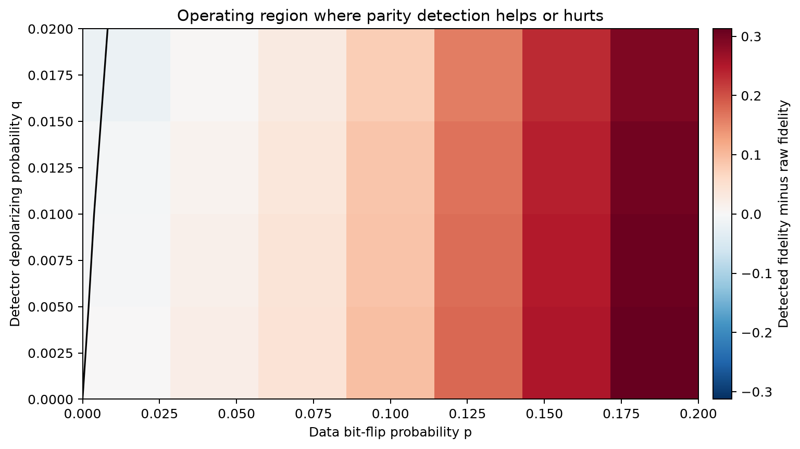

# Q TRUST

## When Does Error Detection Make a Bell Pair Worth Trusting

**Research question:** At what data-noise levels does parity-based error detection improve a Bell-state experiment, and when does the detector overhead outweigh the benefit?

Our seeded Qiskit Aer experiment shows the tradeoff directly. At data bit-flip probability `p=0.10`, raw target-state fidelity was **0.821 +/- 0.003**. Ideal parity detection raised conditional fidelity to **1.000** while accepting **81.9%** of shots, or about **1.22 raw shots per retained shot**. A detector with two-qubit depolarizing probability `q=0.02` still reached **0.981 +/- 0.001**, but the same imperfect detector reduced fidelity when the data channel was already ideal. Error detection helps only when the errors it removes outweigh the errors and sampling cost it introduces.



## Track 3 Challenge Mapping

| Track requirement | Q TRUST implementation |
|---|---|
| Known correct answer | The target is the Bell state `|Phi+> = (|00> + |11>)/sqrt(2)` with exact correlations `XX=1`, `YY=-1`, `ZZ=1`. |
| Ideal and noisy baselines | Seeded Aer simulation sweeps independent data-qubit bit flips from `p=0.00` to `0.20` and compares raw fidelity with `F=(1-p)^2+p^2`. |
| Error handling | An ancilla measures even Z parity. Syndrome-one shots are rejected before all three correlation estimates. |
| Improvement versus cost | Every result reports fidelity uncertainty, accepted shots, shot multiplier, qubits, depth, gates, CNOTs, and measurements. |

This project follows the general "Catch the Error" direction in the Qompute Track 3 brief and extends it with a detector-noise operating map.

## Experiment

The raw circuit prepares `|Phi+>` with a Hadamard and CNOT. An explicit Aer Pauli channel then applies an independent X error to each data qubit with probability `p`.



The protected circuit adds one syndrome ancilla. Two CNOTs copy the data qubits' Z parity onto the ancilla. The experiment accepts `s=0` and rejects `s=1`. Detector imperfections are modeled by a two-qubit depolarizing channel after each parity-check CNOT with `q` in `{0, 0.005, 0.010, 0.020}`.



Z-basis agreement alone cannot distinguish an entangled Bell state from a classical mixture of `00` and `11`. Q TRUST therefore measures X, Y, and Z correlations and estimates target-state fidelity as

```text
F(Phi+) = [1 + <XX> - <YY> + <ZZ>] / 4
```

For each correlation `C`, the standard error is `sqrt((1-C^2)/N)`, using retained shots after postselection. The three correlation errors are propagated into the fidelity error. All settings use 8,192 shots per basis, simulator seed 2026, transpiler seed 2026, and transpiler optimization level 0.

## Results

The raw simulation followed the analytic bit-flip curve with a maximum absolute fidelity deviation of **0.0072** across the sweep. The ideal detector rejected every observed odd-parity event, so its retained sample had unit target fidelity in this controlled channel.

<!-- RESULTS_TABLE_START -->
| p | Raw fidelity | Detected fidelity | Acceptance | Shot multiplier | Helped? |
|---:|---:|---:|---:|---:|:---:|
| 0.02 | 0.956 +/- 0.002 | 1.000 +/- 0.000 | 0.962 | 1.04x | Yes |
| 0.05 | 0.905 +/- 0.002 | 1.000 +/- 0.000 | 0.900 | 1.11x | Yes |
| 0.10 | 0.821 +/- 0.003 | 1.000 +/- 0.000 | 0.819 | 1.22x | Yes |
| 0.20 | 0.687 +/- 0.004 | 1.000 +/- 0.000 | 0.679 | 1.47x | Yes |
<!-- RESULTS_TABLE_END -->

The experiment script regenerates this table from `results/summary_results.csv`; no result is entered by hand.

### Accuracy and Sampling Cost

Detection's conditional-fidelity gain comes from discarding data. At `p=0.20`, it retained 67.9% of shots, so each retained event cost about 1.47 raw shots. The cost plot compares simulated acceptance with the analytic even-error probability.



### Circuit Cost

These are maximum counts across the X, Y, and Z measurement circuits after transpilation for Aer at optimization level 0. Noise-channel instructions are excluded from gate counts because they describe the simulated environment rather than executable correction gates.

| Resource | Raw | Parity detected | Added cost |
|---|---:|---:|---:|
| Qubits | 2 | 3 | +1 |
| CNOTs | 1 | 3 | +2 |
| Measurements | 2 | 3 | +1 |
| Maximum depth | 5 | 7 | +2 |
| Maximum transpiled gate count | 6 | 8 | +2 |

### Detector Usefulness

The detector-noise grid separates two regimes. With perfect data at `p=0`, detector depolarizing noise only caused harm: at `q=0.02`, target fidelity fell by 0.0178. At the first nonzero grid point, `p=0.01`, all tested detectors produced a positive conditional-fidelity gain, although the `q=0.02` gain was only 0.0041. At `p=0.10, q=0.02`, detection improved fidelity by 0.1606 while accepting 80.6% of shots.



The black contour is the sampled boundary where detected and raw fidelity are equal. The grid supports an operating-region claim, not a universal hardware threshold.

## Limits on the Claim

- The controlled channel contains independent X errors and is not a complete IBM hardware model.
- The Z-parity check catches odd parity changes. It does not detect arbitrary phase errors.
- This is error detection with postselection, not fault-tolerant error correction.
- Real detector CNOTs add errors, routing, calibration drift, and execution time that this compact model does not fully represent.
- Simulator evidence does not establish practical hardware performance.
- Fidelity estimates have finite-shot uncertainty. The reported zero plug-in error for an observed perfect correlation follows the specified estimator and does not prove a zero true error rate.
- The 0.5 target-state witness concerns overlap with `|Phi+>`; it is not universal certification of a device or application.

## Societal Impact

Trust has an access cost. Postselection uses extra qubits and gates, consumes more shots, and discards paid cloud results. At the high end of this experiment, retaining one shot required about 1.47 raw shots. Well-funded groups can repeat experiments until uncertainty shrinks, while students and smaller institutions may have to accept weaker evidence.

Quantum results should therefore publish raw and handled outcomes together with acceptance, resource overhead, noise assumptions, and uncertainty. Reporting only the improved postselected number can mislead people who later rely on quantum claims in medicine, finance, energy, or public policy.

## Reproduce in WSL

The project is developed and verified in a Conda environment inside Ubuntu 22.04 while the code remains on drive E.

```bash
cd /mnt/e/QomputeCode
~/miniconda3/bin/conda env create -f environment.yml
~/miniconda3/bin/conda run -n qtrust python run_experiment.py
~/miniconda3/bin/conda run -n qtrust pytest
~/miniconda3/bin/conda run -n qtrust jupyter nbconvert \
  --to notebook --execute --inplace notebooks/QTrust_Demo.ipynb
```

If the `qtrust` environment already exists, update it with:

```bash
~/miniconda3/bin/conda env update -n qtrust -f environment.yml --prune
```

Useful runner options are `--shots`, `--seed`, `--skip-detector-grid`, and `--output-dir`.

## Repository Guide

```text
src/qtrust/             circuit, analysis, experiment, and plotting modules
run_experiment.py       one-command reproducible workflow
tests/                  focused scientific and integration checks
results/                basis-level and aggregated CSV data
figures/                generated circuits and result figures
notebooks/              executed judge-facing demonstration
presentation/           eight-slide outline and 6-7 minute script
CHALLENGE_README.md      preserved organizer brief
CITATIONS.md             sources and reused-material disclosures
```

## Team and Submission

- Team members: **Replace with team names before submission**
- Contributions: **Replace with each member's contribution before submission**
- Video: **Replace with the final 5-10 minute presentation link**

## References and License

See [CITATIONS.md](CITATIONS.md) for the challenge, Qiskit, Bell-state, and parity-check sources. The code is released under the [MIT License](LICENSE). No code or prose from the supplied starter notebook was copied into the implementation.

